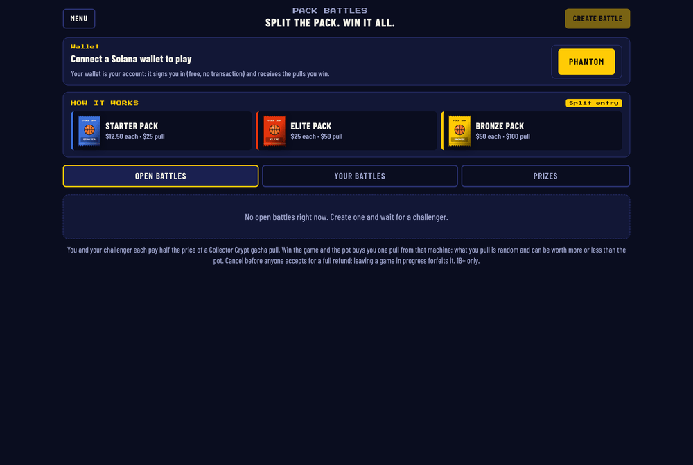
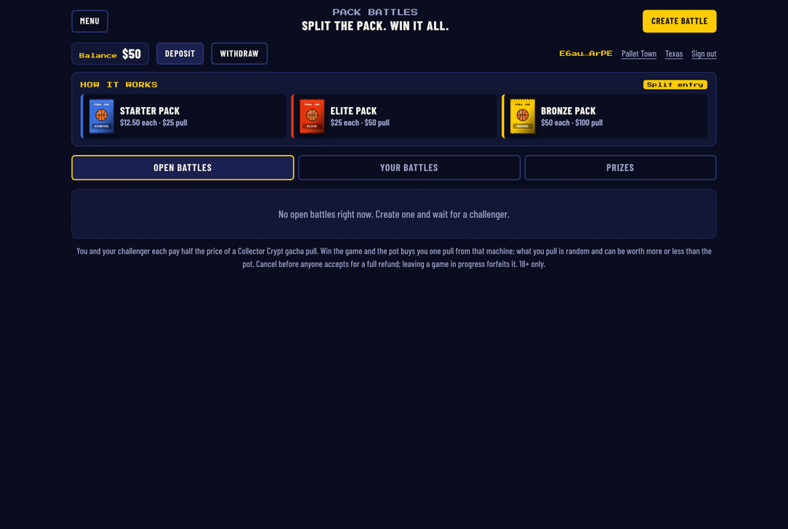
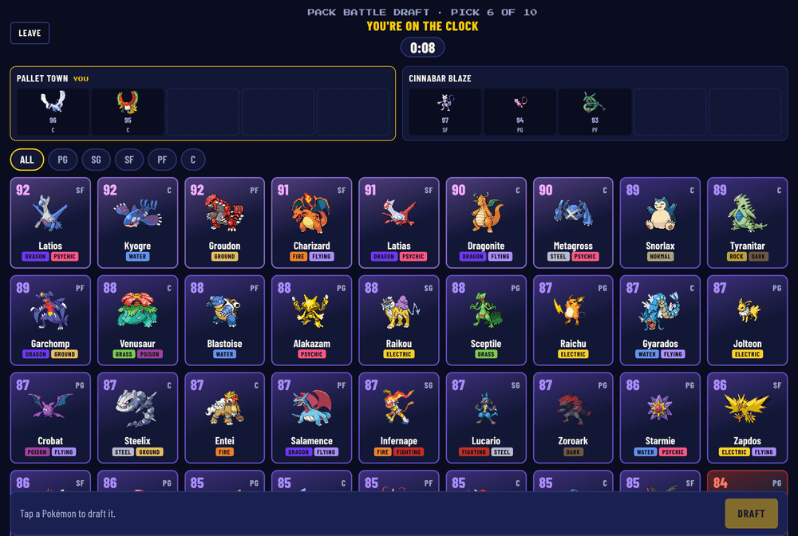
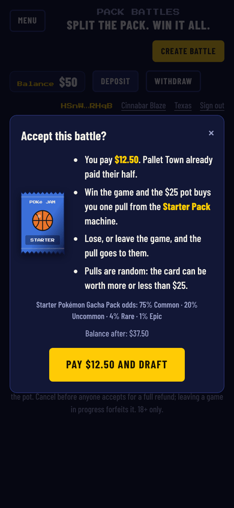
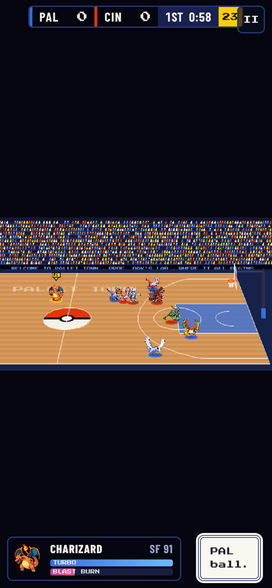
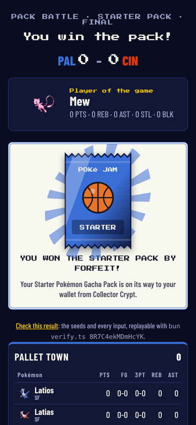

# Pack Battles: play for Collector Crypt pulls

Two players split the cost of a Collector Crypt gacha pull, snake-draft five Pokémon each live, see the exact card they're playing for, and play one online game of Poké Jam. The winner gets the card in their Solana wallet. Collector Crypt's VRF picks the card and also seeds the game.

> **Building this from the PR?** Start with [IMPLEMENTATION.md](IMPLEMENTATION.md). It's the full build spec: the design, the fairness rules, every file, what's tested, what's unconfirmed about Collector Crypt's API, and the remaining tasks with done-criteria.

This PR adds the feature end to end: the game client, an authoritative battle server, wallet sign-in, a USDC ledger and escrow, real-time online play, Collector Crypt pulls with their VRF, card delivery, and a public proof for every result. It's built and tested here. What's left before launch, in order, is in **[IMPLEMENTATION.md](IMPLEMENTATION.md)**: a devnet dry run, a CC API key, deployment, and a few product tasks.

| | | |
| --- | --- | --- |
|  |  |  |
|  |  |  |

## How a battle works

1. **Sign in.** Connect Phantom, Solflare or Backpack and sign a one-time message. This is free and sends no transaction. Players confirm they're 18+ and pick their state.
2. **Deposit.** Players send USDC from that wallet to the house wallet, using a Solana Pay link or the address. The server sees the transfer on chain and credits their balance.
3. **Post or accept.** Each side pays half the machine price into escrow: $12.50 for a $25 Starter pull, $25 for a $50 Elite pull, $50 for a $100 Bronze pull. These are Collector Crypt's real public Pokémon machines, and their odds are shown before anyone pays. Cancelling before someone accepts refunds you.
4. **Draft live.** It's a snake draft with a pick clock, and a missed clock auto-picks. Who picks first comes from the committed seeds, so the server can't choose it.
5. **Pull.** The pot buys one pull from Collector Crypt's public Gacha Machine API, signed by the house wallet, and opens it. Collector Crypt's VRF (ECVRF on Ed25519, committed on-chain) picks the card. Both players see the card, with links to verify the draw, for 8 seconds before tip-off.
6. **Play.** The game's random rolls are seeded from the server seed, both players' seeds and the pull's VRF output, so nobody, the server included, knew the seed before the draft ended. The game runs in lockstep: the server runs its own copy and decides the winner, and clients only send stick and button input. Leaving forfeits after a grace period. If nobody shows up, or the server restarts mid-game, the battle is called off and both players are refunded; the card stays with the house and can be sold back to CC.
7. **Get the card.** The server transfers the card (a Metaplex Core asset) from the house wallet to the winner. It never buys twice and never sends twice: the memo is saved the moment CC has the payment, and on-chain ownership is checked before every transfer.
8. **Check it.** Every result has a public proof: all seeds (the server seed's hash was published when the battle was posted), the CC memo and VRF record, the draft, and every tick of input. `bun verify.ts <battle-id>` checks each step, confirms the VRF with Collector Crypt, and replays the game through the real engine.

With no server configured, Pack Battles still works as an offline preview using play money and CPU challengers.

## What changed

**Engine (`src/game/`)**
- The simulation is deterministic. Every random roll comes from a seeded RNG (`game.rng`), so the same seed and inputs produce the identical game.
- One human per team, with `viewTeam` deciding whose HUD, ring and tip-off meter a screen shows.
- `sync.ts` adds input packing, a fixed tick, a state hash, and snapshot/restore.
- Single-player, franchise and simulated games behave as before.

**Client**
- `src/screens/battles.ts`: the lobby, including wallet, balance, deposit, withdraw, eligibility, create/accept and prizes.
- `src/screens/online.ts`: the waiting room, live draft, the card reveal with verify links, online game, reconnects and results.
- `src/ui/pack.ts`: pack art and the graded-slab card shown at the reveal, in results and in prizes.
- `src/net/`: protocol, lockstep client, wallet connector, HTTP backend and shared byte helpers.
- `src/battles/`: the Collector Crypt tiers, the backend interface, and the offline preview.

**Server (`server/`)**
- A Bun + SQLite server with no runtime packages: auth, ledger, deposit scanner, battles and escrow, match rooms, Collector Crypt client (buy, open, VRF, buyback), Metaplex Core transfers, prize worker, Solana transaction signing, admin API and proof verifier.
- See `server/README.md` for how it works, configuration (`server/.env.example`), the house wallet, and the admin API.

**CI and docs**
- `.github/workflows/server.yml` typechecks and runs the server tests.
- `pages.yml` passes the `VITE_API_URL` repo variable to the build, so the deployed game points at the server and its Content Security Policy allows it.
- The README is updated, plus `server/README.md` and `IMPLEMENTATION.md`.

## Testing

`cd server && bun test` runs 26 tests:
- **Unit:** base58, house-key loading, signing legacy and v0 transactions while keeping CC's signature, building and signing a Core transfer, ledger idempotency and overdrafts, escrow (create, accept, cancel, void, finish), eligibility, deposit crediting by sender, seed derivation from VRF output, and every prize path: buying, resuming a paid pull without buying again, a forfeit before the pull, retries, checking ownership after a crash mid-transfer instead of sending again, and buyback.
- **End to end:**
  - Two players sign in with real Ed25519 keys and play a full lockstep game. Both clients end on the server's exact score with zero desyncs. Both see the same card before tip-off. The card moves on a fake chain that only accepts a correctly signed Core transfer. The proof verifies, including a live VRF check against a fake Collector Crypt, and forged seeds or a swapped VRF record fail.
  - A mid-game quit forfeits.
  - If both players leave after the pull, both are refunded and the card stays with the house.
  - A no-show refunds both players.
  - The API refuses bad input, missing funds, minors and non-admins.

Also checked:
- **Engine:** two copies with the same seed and inputs matched on every one of 10,620 ticks, and a copy restored from a mid-game snapshot finished identically.
- **Browsers:** two headless browsers with test wallets signed in, deposited (admin credit), posted and accepted a battle, drafted live, saw the card reveal, played, and finished by forfeit, with the card shown "In your wallet" to the winner. Both screens showed the same game clock and there were no console errors. The offline preview flow was also re-run.

## Before merging or launching

See [IMPLEMENTATION.md](IMPLEMENTATION.md). In short:
1. Do a devnet dry run with real wallets and CC's devnet gacha.
2. Get a CC API key, and confirm machine prices and the open questions about CC's API listed in IMPLEMENTATION.md section 5.
3. Deploy the server with secrets, a volume, HTTPS and a paid RPC.
4. Set the `VITE_API_URL` repo variable.
5. Update `public/privacy.html` and add terms.
6. Set `RESTRICTED_REGIONS` per your counsel.

🤖 Generated with [Claude Code](https://claude.com/claude-code)

https://claude.ai/code/session_01Lu5NxoSP8PwbNRF1z2KCLG
